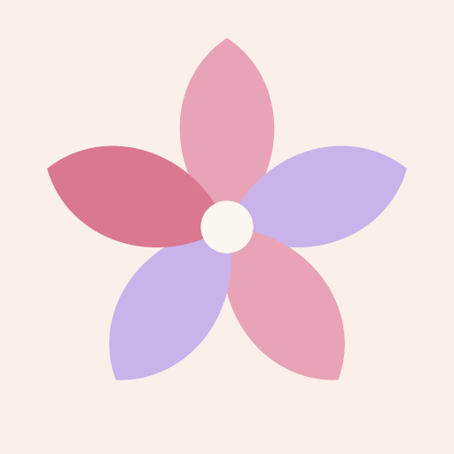
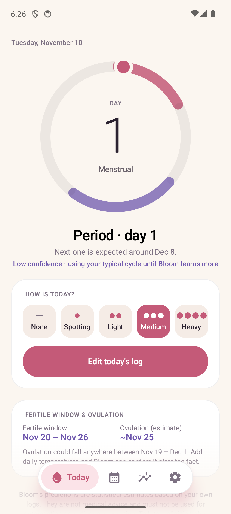
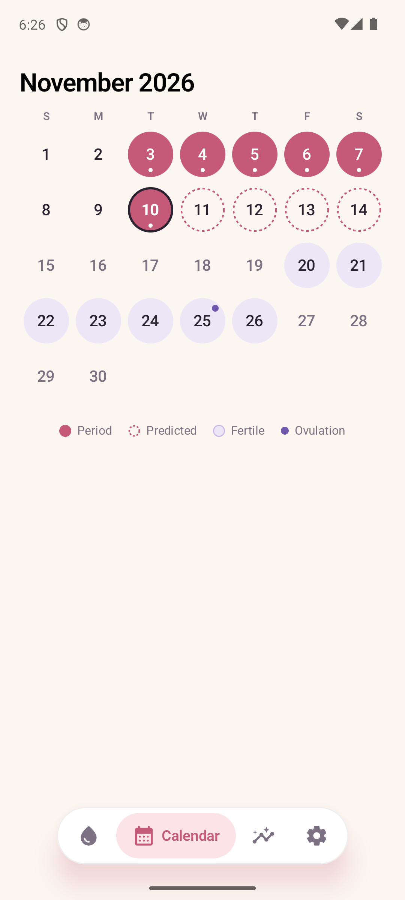
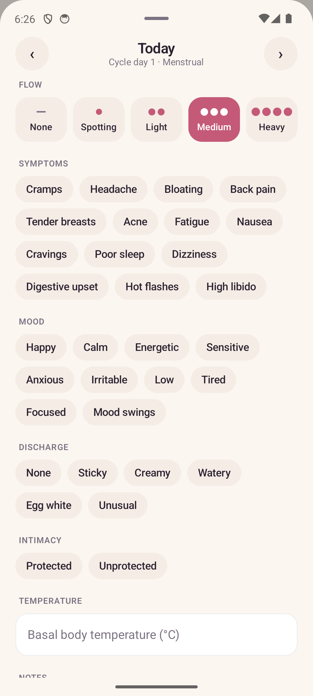
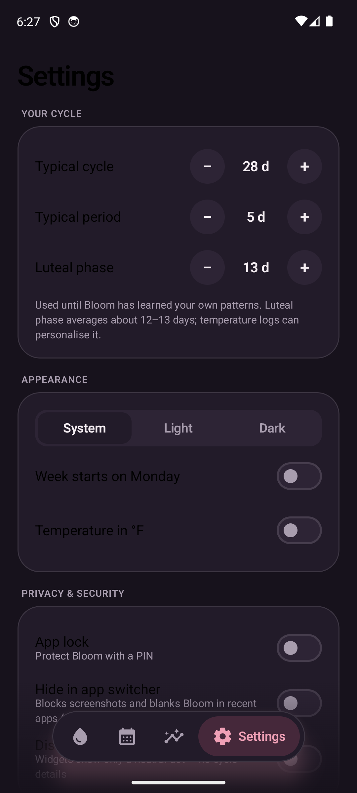
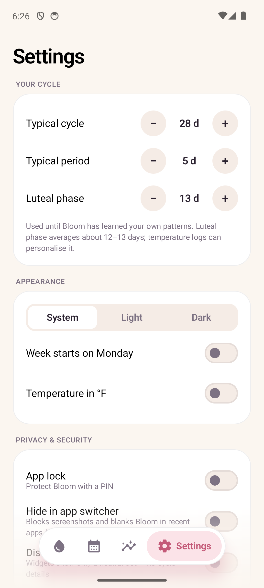

<div align="center">



# Bloom

**A private, beautiful cycle tracker that never leaves your phone.**

100% offline · no account · no cloud · no ads · no `INTERNET` permission

[](https://appdrop-store.vercel.app/apps/bloom)
[](https://github.com/manojanasuri16/Bloom/releases)
[](LICENSE)


<br />







</div>

<br />

## ✨ Features

| | |
|---|---|
| 🌸 **Effortless tracking** | Flow, symptoms, mood, discharge, intimacy, basal temperature and notes. Everything autosaves. |
| 🎯 **Honest predictions** | The next period is a *window* with a confidence tier, never a false-precision date. Fertile window and ovulation are labelled estimates. Temperature logs (3-over-6 rule) confirm ovulation and personalise your luteal phase. |
| 📅 **Calendar & insights** | Phase-tinted month view, cycle-length chart and variability, symptom and mood patterns, temperature chart. |
| 🧩 **Widgets** | Small 2×2 ring, medium 4×2 with a 7-day strip, large 4×4 two-week grid. A *Discreet* mode shows only a neutral dot. |
| 🔒 **Real privacy** | AES-256-GCM with a non-exportable Android Keystore key, optional PIN (PBKDF2, lockout) and biometrics, screenshot/recents blocking, OS backup and device transfer disabled. |
| 📦 **Your data, portable** | JSON and CSV export, password-encrypted backups (PBKDF2-600k + AES-GCM), restore with preview, merge or replace. Uses the system file picker, so no storage permissions. |
| 🌗 **Light & dark** | Plus optional neutral reminders. The only permission is the optional notification permission. |

## 📲 Install

Get the signed APK from **[AppDrop](https://appdrop-store.vercel.app/apps/bloom)** ([direct download](https://appdrop-store.vercel.app/d/bloom)) or the [Releases](https://github.com/manojanasuri16/Bloom/releases) page, and open it on an Android 8.0+ phone.

Official releases are signed with a private key, so APKs you build yourself won't update in place over them.

## 🛠 Build

```bash
./gradlew testDebugUnitTest assembleDebug   # APK in app/build/outputs/apk/debug
./gradlew assembleRelease                   # signs with BLOOM_STORE_* from ~/.gradle/gradle.properties, else debug key
```

Kotlin 2.1 · Jetpack Compose · Glance 1.1 · WorkManager · min SDK 26 · target SDK 36

## 📚 Docs

- [`docs/ARCHITECTURE.md`](docs/ARCHITECTURE.md): design decisions, algorithm, security model
- [`docs/RESEARCH.md`](docs/RESEARCH.md): competitor, science and platform research

## 🤝 License & contributing

Bloom is free and open-source software under the [GNU GPL v3](LICENSE) (or later). You may use, study, modify and share it, provided derivative works stay open under the same license. That keeps closed forks with trackers or ads out of the picture.

Issues and pull requests are welcome.

<div align="center">
<sub>Bloom's predictions are statistical estimates, not medical advice, and must not be used for contraception.</sub>
</div>
